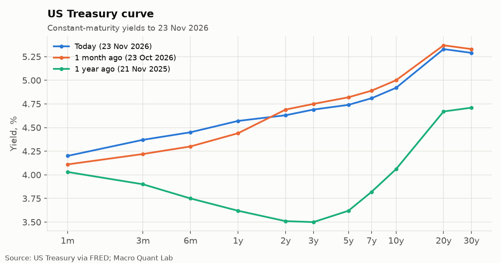

# Daily Macro Desk · Fri 20 Nov 2026

## Nikkei 225 lost 5.06% to 56,437, about 2.7x a normal day's move

### Global markets

- S&P 500 lost 2.02% to 7,176, about 2.3x a normal day's move.
- VIX gained 3.88 to 28.44, about 2.3x a normal day's move.
- US 5y5y forward inflation fell 5 bp to 2.10%, about 2.1x a normal day's move.
- Gold lost 3.67% to 3,550, about 2.1x a normal day's move.
- Hang Seng lost 2.14% to 22,353, about 1.8x a normal day's move.
- US 10y Treasury fell 3 bp to 5.07%.
- UK 10y gilt (zero coupon) rose 4 bp to 5.37%.
- Euro AAA 10y fell 1 bp to 3.41%.

The US 2s10s curve is positively sloped at 27 bp. Credit: spreads wide versus the past year. Equity volatility looks stressed. US 10-year breakeven inflation is between 2% and 2.5%.

### India

- Nifty 50 gained 0.79% to 25,715.
- Sensex gained 0.74% to 83,635.
- Nifty Bank gained 1.94% to 64,283, about 1.7x a normal day's move.
- India VIX gained 1.24 to 17.35.
- USD/INR lost 0.51% to 92.98.
- India 10y G-sec (monthly): 7.38% (latest monthly reading, 2026-10).

[All charts →](monitor.md)

## The table

| | Level | 1d | 1w | 1m | z (1y) | As of |
|---|---:|---:|---:|---:|---:|---|
| **US rates** | | | | | | |
| US 3m T-bill | 4.34% | +1 bp | +4 bp | +8 bp | +2.5 | 2026-11-18 |
| US 2y Treasury | 4.80% | +0 bp | +7 bp | +6 bp | +1.7 | 2026-11-18 |
| US 5y Treasury | 4.89% | -1 bp | +8 bp | +0 bp | +1.6 | 2026-11-18 |
| US 10y Treasury | 5.07% | -3 bp | +9 bp | -2 bp | +1.6 | 2026-11-18 |
| US 30y Treasury | 5.41% | -5 bp | +6 bp | -2 bp | +1.5 | 2026-11-18 |
| SOFR | 3.90% | -2 bp | +1 bp | +2 bp | +1.6 | 2026-11-18 |
| US 2s10s curve | 27 bp | -3 bp | +2 bp | -8 bp | -1.7 | 2026-11-18 |
| US 5s30s curve | 52 bp | -4 bp | -2 bp | -2 bp | -1.7 | 2026-11-18 |
| **UK rates** | | | | | | |
| UK 5y gilt (zero coupon) | 5.01% | +3 bp | +17 bp | +10 bp | +1.8 | 2026-11-17 |
| UK 10y gilt (zero coupon) | 5.37% | +4 bp | +18 bp | +4 bp | +1.6 | 2026-11-17 |
| UK 20y gilt (zero coupon) | 5.86% | +5 bp | +20 bp | +0.1 bp | +1.2 | 2026-11-17 |
| SONIA | 3.98% | +0.1 bp | +0 bp | +25 bp | +2.8 | 2026-11-17 |
| UK minus US 10y | 27 bp | +6 bp | +6 bp | +3 bp | -1.1 | 2026-11-17 |
| UK 5s20s curve | 86 bp | +2 bp | +2 bp | -10 bp | -2.3 | 2026-11-17 |
| **Euro rates** | | | | | | |
| Euro AAA 2y | 3.09% | -0.7 bp | +4 bp | +6 bp | +1.5 | 2026-11-18 |
| Euro AAA 10y | 3.41% | -1 bp | +7 bp | -3 bp | +1.4 | 2026-11-18 |
| €STR | 2.44% | -0.1 bp | -0.2 bp | +0 bp | +1.8 | 2026-11-19 |
| Euro AAA 2s10s curve | 32 bp | -0.8 bp | +3 bp | -9 bp | -1.4 | 2026-11-18 |
| **Inflation** | | | | | | |
| US 10y real yield (TIPS) | 2.88% | -1 bp | +10 bp | +14 bp | +2.0 | 2026-11-18 |
| US 10y breakeven | 2.16% | -3 bp | -8 bp | -19 bp | -2.2 | 2026-11-19 |
| US 5y5y forward inflation | 2.10% | -5 bp | -7 bp | -22 bp | -1.7 | 2026-11-19 |
| UK 10y real yield | 2.20% | +4 bp | +15 bp | +23 bp | +2.5 | 2026-11-17 |
| UK 10y implied inflation | 3.17% | +0 bp | +4 bp | -20 bp | -0.4 | 2026-11-17 |
| **Credit** | | | | | | |
| US IG credit spread | 93 bp | +1 bp | +3 bp | +8 bp | +2.4 | 2026-11-18 |
| US high-yield spread | 347 bp | +4 bp | +17 bp | +16 bp | +2.6 | 2026-11-18 |
| **Equities** | | | | | | |
| S&P 500 | 7,176 | -2.02% | -5.49% | -6.70% | -0.2 | 2026-11-19 |
| Nasdaq 100 | 26,517 | -2.21% | -6.26% | -10.20% | -0.5 | 2026-11-19 |
| Euro Stoxx 50 | 6,114 | -0.66% | -4.46% | -0.50% | +0.2 | 2026-11-19 |
| FTSE 100 | 10,453 | -0.93% | -3.78% | -2.90% | +0.1 | 2026-11-19 |
| Nikkei 225 | 56,437 | -5.06% | -7.70% | -11.92% | -0.6 | 2026-11-20 |
| Hang Seng | 22,353 | -2.14% | -5.44% | -6.35% | -2.7 | 2026-11-20 |
| Shanghai Composite | 3,534 | -1.23% | -2.77% | -5.40% | -2.8 | 2026-11-20 |
| KOSPI | 4,870 | -5.21% | -7.95% | -12.30% | -1.0 | 2026-11-20 |
| **Volatility** | | | | | | |
| VIX | 28.44 | +3.88 | +9.74 | +10.00 | +3.0 | 2026-11-19 |
| MOVE (rates vol) | 96.04 | -2.11 | -2.39 | -5.26 | +1.4 | 2026-11-19 |
| **FX** | | | | | | |
| Dollar index | 103.76 | -0.13% | +0.34% | +1.95% | +2.6 | 2026-11-20 |
| EUR/USD | 1.0988 | +0.14% | -0.56% | -2.13% | -2.8 | 2026-11-20 |
| GBP/USD | 1.3121 | -0.20% | -0.84% | -1.89% | -2.1 | 2026-11-20 |
| USD/JPY | 159.17 | -0.13% | -0.44% | +0.57% | +0.4 | 2026-11-20 |
| USD/CNH | 6.6743 | +0.13% | +0.03% | -0.05% | -0.2 | 2026-11-20 |
| **Commodities** | | | | | | |
| Brent crude | 89.92 | -2.24% | -6.18% | -17.37% | +0.1 | 2026-11-20 |
| Gold | 3,550 | -3.67% | -8.65% | -14.45% | -2.5 | 2026-11-20 |
| Copper | 5.5175 | -1.91% | -9.24% | -15.67% | -1.4 | 2026-11-20 |
| **India** | | | | | | |
| Nifty 50 | 25,715 | +0.79% | +2.27% | +12.35% | +1.2 | 2026-11-20 |
| Sensex | 83,635 | +0.74% | +2.50% | +13.24% | +1.3 | 2026-11-20 |
| Nifty Bank | 64,283 | +1.94% | +5.32% | +15.85% | +2.9 | 2026-11-20 |
| India VIX | 17.35 | +1.24 | +1.85 | +2.58 | +0.7 | 2026-11-20 |
| USD/INR | 92.98 | -0.51% | -1.12% | -1.83% | -0.3 | 2026-11-20 |
| India 10y G-sec (monthly) | 7.38% | +32 bp | +32 bp | +32 bp | – | 2026-10-01 |

<small>Data quality: 55 ok, 0 warnings, 0 failures. Written by: template.</small>

*Personal research on public data. Not investment advice. Views are my own and not those of any employer. Numbers can be wrong; check the source before relying on them.*
