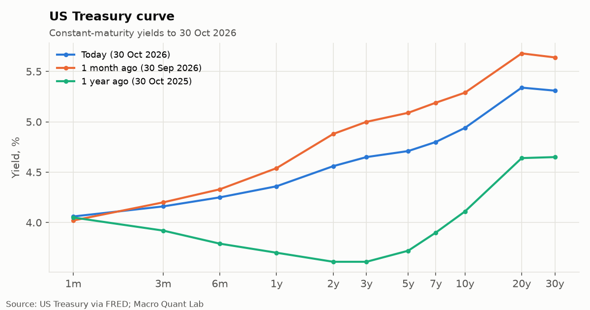

# Daily Macro Desk · Mon 02 Nov 2026

## US IG credit spread rose 3 bp to 89 bp, about 2.8x a normal day's move

### Global markets

- Nasdaq 100 lost 3.46% to 28,385, about 2.8x a normal day's move.
- US high-yield spread rose 12 bp to 326 bp, about 2.3x a normal day's move.
- S&P 500 lost 1.82% to 7,580, about 2.3x a normal day's move.
- US 10y Treasury fell 7 bp to 4.98%, about 1.6x a normal day's move.
- MOVE (rates vol) gained 6.66 to 100.20, about 1.5x a normal day's move.
- UK 10y gilt (zero coupon) rose 0.3 bp to 5.33%.
- Euro AAA 10y fell 2 bp to 3.37%.
- Nikkei 225 lost 0.02% to 63,278.

The US 2s10s curve is positively sloped at 37 bp. Credit: spreads wide versus the past year. Equity volatility looks normal. US 10-year breakeven inflation is between 2% and 2.5%.

### India

- Nifty 50 gained 1.21% to 23,333.
- Sensex gained 1.34% to 75,460, about 1.5x a normal day's move.
- Nifty Bank gained 0.33% to 54,870.
- India VIX gained 0.29 to 15.60.
- USD/INR lost 0.29% to 94.88.
- India 10y G-sec (monthly): 7.06% (latest monthly reading, 2026-09).

[All charts →](monitor.md)

## The table

| | Level | 1d | 1w | 1m | z (1y) | As of |
|---|---:|---:|---:|---:|---:|---|
| **US rates** | | | | | | |
| US 3m T-bill | 4.18% | +0 bp | -4 bp | -7 bp | +2.0 | 2026-10-29 |
| US 2y Treasury | 4.61% | -6 bp | -4 bp | -28 bp | +1.5 | 2026-10-29 |
| US 5y Treasury | 4.78% | -7 bp | +0 bp | -28 bp | +1.6 | 2026-10-29 |
| US 10y Treasury | 4.98% | -7 bp | +2 bp | -28 bp | +1.6 | 2026-10-29 |
| US 30y Treasury | 5.32% | -5 bp | +3 bp | -27 bp | +1.3 | 2026-10-29 |
| SOFR | 3.94% | +0 bp | +4 bp | +6 bp | +1.7 | 2026-10-29 |
| US 2s10s curve | 37 bp | -1 bp | +6 bp | +0 bp | -1.1 | 2026-10-29 |
| US 5s30s curve | 54 bp | +2 bp | +3 bp | +1 bp | -1.8 | 2026-10-29 |
| **UK rates** | | | | | | |
| UK 5y gilt (zero coupon) | 4.98% | +2 bp | +1 bp | +0.3 bp | +1.9 | 2026-10-28 |
| UK 10y gilt (zero coupon) | 5.33% | +0.3 bp | -4 bp | -9 bp | +1.5 | 2026-10-28 |
| UK 20y gilt (zero coupon) | 5.77% | -1 bp | -7 bp | -19 bp | +0.9 | 2026-10-28 |
| SONIA | 3.73% | -0 bp | -0 bp | +0.4 bp | -0.3 | 2026-10-28 |
| UK minus US 10y | 28 bp | -6 bp | +4 bp | +10 bp | -1.2 | 2026-10-28 |
| UK 5s20s curve | 79 bp | -2 bp | -8 bp | -20 bp | -3.5 | 2026-10-28 |
| **Euro rates** | | | | | | |
| Euro AAA 2y | 3.01% | -5 bp | +0.1 bp | -20 bp | +1.4 | 2026-10-29 |
| Euro AAA 10y | 3.37% | -2 bp | -1 bp | -23 bp | +1.3 | 2026-10-29 |
| €STR | 2.44% | +0 bp | -0.3 bp | +0 bp | +2.1 | 2026-10-29 |
| Euro AAA 2s10s curve | 37 bp | +3 bp | -1 bp | -3 bp | -1.4 | 2026-10-29 |
| **Inflation** | | | | | | |
| US 10y real yield (TIPS) | 2.63% | -4 bp | -1 bp | -28 bp | +1.5 | 2026-10-29 |
| US 10y breakeven | 2.34% | -1 bp | +0 bp | -2 bp | +0.3 | 2026-10-30 |
| US 5y5y forward inflation | 2.22% | -1 bp | +2 bp | -14 bp | -0.1 | 2026-10-30 |
| UK 10y real yield | 1.96% | -0.6 bp | -3 bp | -0.9 bp | +1.6 | 2026-10-28 |
| UK 10y implied inflation | 3.37% | +0.9 bp | -2 bp | -8 bp | +0.8 | 2026-10-28 |
| **Credit** | | | | | | |
| US IG credit spread | 89 bp | +3 bp | +0 bp | +5 bp | +2.0 | 2026-10-29 |
| US high-yield spread | 326 bp | +12 bp | -14 bp | +18 bp | +1.9 | 2026-10-29 |
| **Equities** | | | | | | |
| S&P 500 | 7,580 | -1.82% | -0.57% | -0.93% | +0.9 | 2026-10-30 |
| Nasdaq 100 | 28,385 | -3.46% | -1.98% | -6.66% | +0.4 | 2026-10-30 |
| Euro Stoxx 50 | 6,131 | -1.22% | +1.04% | -2.20% | +0.4 | 2026-10-30 |
| FTSE 100 | 10,730 | +0.07% | +0.37% | +1.17% | +1.0 | 2026-10-30 |
| Nikkei 225 | 63,278 | -0.02% | +1.75% | -7.37% | +0.5 | 2026-11-02 |
| Hang Seng | 23,481 | +0.80% | +1.16% | -2.05% | -1.9 | 2026-11-02 |
| Shanghai Composite | 3,646 | +1.31% | -1.39% | -5.10% | -2.6 | 2026-11-02 |
| KOSPI | 5,896 | +2.88% | +7.79% | -15.82% | -0.1 | 2026-11-02 |
| **Volatility** | | | | | | |
| VIX | 19.42 | +2.22 | -0.03 | +3.08 | +0.4 | 2026-10-30 |
| MOVE (rates vol) | 100.20 | +6.66 | -3.11 | -10.25 | +1.9 | 2026-10-30 |
| **FX** | | | | | | |
| Dollar index | 101.83 | -0.02% | -0.48% | -0.10% | +1.7 | 2026-11-02 |
| EUR/USD | 1.1186 | +0.03% | -0.28% | -0.57% | -2.2 | 2026-11-02 |
| GBP/USD | 1.3400 | +0.16% | +0.16% | +1.52% | -0.0 | 2026-11-02 |
| USD/JPY | 157.76 | -0.03% | +0.59% | -0.11% | -0.1 | 2026-11-02 |
| USD/CNH | 6.6431 | -0.16% | -0.39% | -0.91% | -2.1 | 2026-11-02 |
| **Commodities** | | | | | | |
| Brent crude | 109.79 | -2.08% | -3.59% | +7.37% | +1.3 | 2026-11-02 |
| Gold | 3,925 | -2.20% | -3.66% | -5.69% | -1.6 | 2026-11-02 |
| Copper | 6.5320 | -0.58% | -1.36% | +0.62% | +1.0 | 2026-11-02 |
| **India** | | | | | | |
| Nifty 50 | 23,333 | +1.21% | +2.55% | +4.06% | -0.9 | 2026-11-02 |
| Sensex | 75,460 | +1.34% | +2.52% | +4.94% | -0.8 | 2026-11-02 |
| Nifty Bank | 54,870 | +0.33% | +0.93% | +0.77% | -1.0 | 2026-11-02 |
| India VIX | 15.60 | +0.29 | -1.56 | +1.13 | +0.3 | 2026-11-02 |
| USD/INR | 94.88 | -0.29% | -0.07% | -1.40% | +0.6 | 2026-11-02 |
| India 10y G-sec (monthly) | 7.06% | +22 bp | +22 bp | +22 bp | – | 2026-09-01 |

<small>Data quality: 55 ok, 0 warnings, 0 failures. Written by: template.</small>

*Personal research on public data. Not investment advice. Views are my own and not those of any employer. Numbers can be wrong; check the source before relying on them.*
