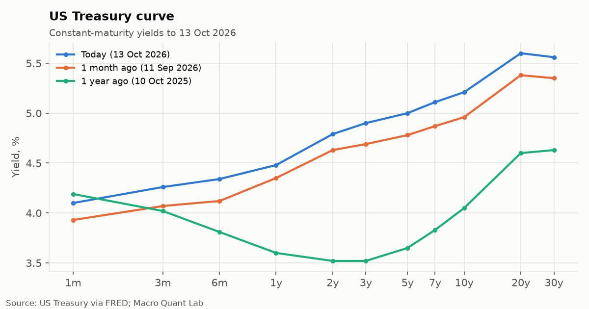

# Daily Macro Desk · Thu 15 Oct 2026

## Nikkei 225 lost 4.64% to 64,601, about 2.5x a normal day's move

### Global markets

- KOSPI lost 7.68% to 5,547, about 2.2x a normal day's move.
- Shanghai Composite lost 1.98% to 3,693, about 2.2x a normal day's move.
- Nasdaq 100 lost 2.02% to 29,951, about 1.6x a normal day's move.
- Dollar index lost 0.50% to 102.04, about 1.6x a normal day's move.
- S&P 500 lost 1.11% to 7,719.
- US 10y Treasury fell 3 bp to 5.21%.
- UK 10y gilt (zero coupon) fell 2 bp to 5.43%.
- Euro AAA 10y fell 0.7 bp to 3.49%.

The US 2s10s curve is positively sloped at 42 bp. Credit: spreads wide versus the past year. Equity volatility looks normal. US 10-year breakeven inflation is between 2% and 2.5%.

### India

- Nifty 50 gained 1.13% to 22,879.
- Sensex gained 1.06% to 73,555.
- Nifty Bank gained 0.57% to 55,630.
- India VIX gained 0.06 to 14.69.
- USD/INR lost 0.30% to 95.00.
- India 10y G-sec (monthly): 6.78% (latest monthly reading, 2026-07).

[All charts →](monitor.md)

## The table

| | Level | 1d | 1w | 1m | z (1y) | As of |
|---|---:|---:|---:|---:|---:|---|
| **US rates** | | | | | | |
| US 3m T-bill | 4.26% | +1 bp | +5 bp | +19 bp | +2.8 | 2026-10-13 |
| US 2y Treasury | 4.79% | -1 bp | +0 bp | +16 bp | +2.2 | 2026-10-13 |
| US 5y Treasury | 5.00% | -2 bp | -3 bp | +22 bp | +2.4 | 2026-10-13 |
| US 10y Treasury | 5.21% | -3 bp | -6 bp | +25 bp | +2.5 | 2026-10-13 |
| US 30y Treasury | 5.56% | -4 bp | -8 bp | +21 bp | +2.4 | 2026-10-13 |
| SOFR | 3.89% | +2 bp | -1 bp | +27 bp | +0.9 | 2026-10-13 |
| US 2s10s curve | 42 bp | -2 bp | -6 bp | +9 bp | -0.8 | 2026-10-13 |
| US 5s30s curve | 56 bp | -2 bp | -5 bp | -1 bp | -2.0 | 2026-10-13 |
| **UK rates** | | | | | | |
| UK 5y gilt (zero coupon) | 4.98% | +0 bp | +4 bp | +10 bp | +2.1 | 2026-10-12 |
| UK 10y gilt (zero coupon) | 5.43% | -2 bp | +1 bp | +8 bp | +2.1 | 2026-10-12 |
| UK 20y gilt (zero coupon) | 5.97% | -3 bp | -2 bp | +0.6 bp | +1.8 | 2026-10-12 |
| SONIA | 3.73% | -0.1 bp | +0 bp | +0.2 bp | -0.5 | 2026-10-12 |
| UK minus US 10y | 21 bp | -5 bp | +13 bp | -21 bp | -2.0 | 2026-10-09 |
| UK 5s20s curve | 99 bp | -3 bp | -6 bp | -9 bp | -2.5 | 2026-10-12 |
| **Euro rates** | | | | | | |
| Euro AAA 2y | 3.08% | +2 bp | +3 bp | -5 bp | +1.8 | 2026-10-13 |
| Euro AAA 10y | 3.49% | -0.7 bp | -3 bp | -3 bp | +2.0 | 2026-10-13 |
| €STR | 2.44% | +0 bp | +0 bp | +25 bp | +2.5 | 2026-10-13 |
| Euro AAA 2s10s curve | 41 bp | -2 bp | -6 bp | +2 bp | -1.2 | 2026-10-13 |
| **Inflation** | | | | | | |
| US 10y real yield (TIPS) | 2.88% | -3 bp | -3 bp | +28 bp | +2.5 | 2026-10-13 |
| US 10y breakeven | 2.35% | +2 bp | -1 bp | -2 bp | +0.5 | 2026-10-14 |
| US 5y5y forward inflation | 2.34% | +1 bp | -1 bp | +0 bp | +1.6 | 2026-10-14 |
| UK 10y real yield | 2.02% | -2 bp | -0.7 bp | +6 bp | +2.1 | 2026-10-12 |
| UK 10y implied inflation | 3.41% | +0.2 bp | +2 bp | +2 bp | +1.1 | 2026-10-12 |
| **Credit** | | | | | | |
| US IG credit spread | 83 bp | +0 bp | +0 bp | +3 bp | +0.8 | 2026-10-13 |
| US high-yield spread | 316 bp | +5 bp | +13 bp | +51 bp | +1.6 | 2026-10-13 |
| **Equities** | | | | | | |
| S&P 500 | 7,719 | -1.11% | -1.06% | +1.30% | +1.4 | 2026-10-14 |
| Nasdaq 100 | 29,951 | -2.02% | -3.88% | +2.83% | +1.2 | 2026-10-14 |
| Euro Stoxx 50 | 6,190 | +0.38% | +0.16% | -1.12% | +0.6 | 2026-10-14 |
| FTSE 100 | 10,725 | +0.70% | +2.55% | +0.26% | +1.0 | 2026-10-14 |
| Nikkei 225 | 64,601 | -4.64% | -6.43% | +1.76% | +0.8 | 2026-10-15 |
| Hang Seng | 23,956 | -1.47% | +0.71% | -2.88% | -1.7 | 2026-10-15 |
| Shanghai Composite | 3,693 | -1.98% | -3.13% | -4.44% | -2.7 | 2026-10-15 |
| KOSPI | 5,547 | -7.68% | -16.28% | -16.30% | -0.3 | 2026-10-15 |
| **Volatility** | | | | | | |
| VIX | 16.87 | +1.60 | +1.79 | -0.23 | -0.3 | 2026-10-14 |
| MOVE (rates vol) | 99.06 | -2.03 | -3.50 | +15.16 | +2.1 | 2026-10-14 |
| **FX** | | | | | | |
| Dollar index | 102.04 | -0.50% | -0.10% | +2.40% | +2.1 | 2026-10-15 |
| EUR/USD | 1.1218 | +0.12% | +0.15% | -2.86% | -2.5 | 2026-10-15 |
| GBP/USD | 1.3244 | -0.10% | +0.22% | -1.90% | -1.1 | 2026-10-15 |
| USD/JPY | 157.89 | -0.27% | -0.11% | +2.27% | +0.1 | 2026-10-15 |
| USD/CNH | 6.6923 | +0.02% | -0.16% | – | – | 2026-10-15 |
| **Commodities** | | | | | | |
| Brent crude | 104.32 | -1.64% | +0.04% | -4.07% | +1.1 | 2026-10-15 |
| Gold | 4,167 | +1.45% | +0.25% | -3.82% | -0.9 | 2026-10-15 |
| Copper | 6.5810 | -0.46% | +0.95% | +3.34% | +1.2 | 2026-10-15 |
| **India** | | | | | | |
| Nifty 50 | 22,879 | +1.13% | +2.91% | -1.04% | -1.5 | 2026-10-15 |
| Sensex | 73,555 | +1.06% | +2.74% | -0.61% | -1.3 | 2026-10-15 |
| Nifty Bank | 55,630 | +0.57% | +2.04% | -0.30% | -0.7 | 2026-10-15 |
| India VIX | 14.69 | +0.06 | -0.59 | +1.26 | +0.1 | 2026-10-15 |
| USD/INR | 95.00 | -0.30% | -1.81% | -0.87% | +0.7 | 2026-10-15 |
| India 10y G-sec (monthly) | 6.78% | -11 bp | -11 bp | -11 bp | – | 2026-07-01 |

<small>Data quality: 55 ok, 0 warnings, 0 failures. Written by: template.</small>

*Personal research on public data. Not investment advice. Views are my own and not those of any employer. Numbers can be wrong; check the source before relying on them.*
